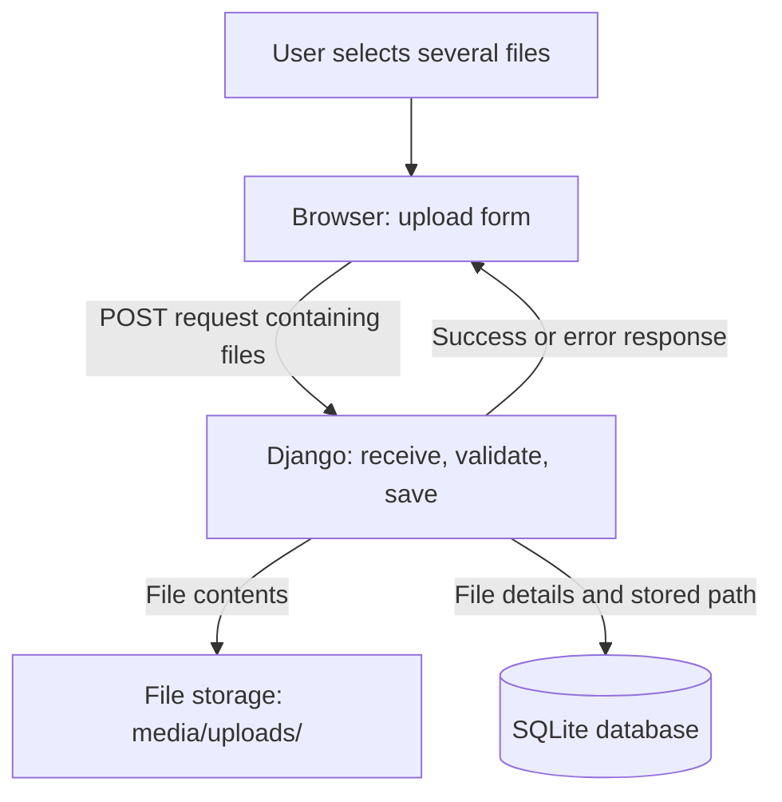
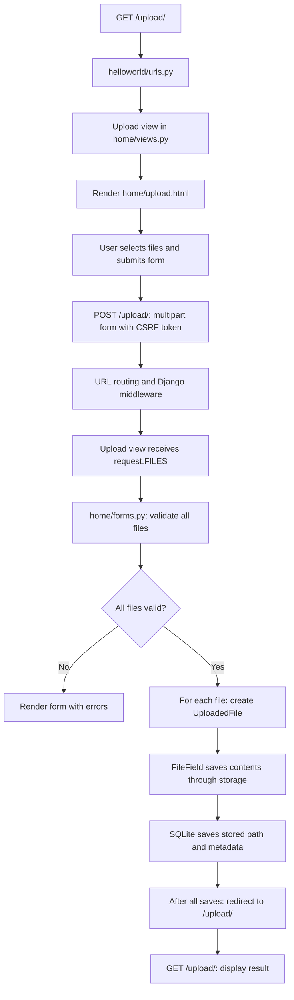

# Multiple file uploads in your Django project

This is a proposed architecture, not an implemented feature. Your current Hello World and About pages remain unchanged. Here, “save in the system” means saving files on the computer running Django: your Mac during local development, or the server after deployment.

## 1. High-level architecture

This diagram shows the main parts and their responsibilities.



1. **Browser:** Shows a form with a file picker and an Upload button. Uploading sends copies; it does not remove the originals.
2. **Django:** Receives the request, checks the selected files, coordinates saving, and sends a result.
3. **File storage:** Holds the actual PDF, image, or other file contents under `media/uploads/`. Django storage determines the final filename and handles name collisions.
4. **SQLite:** Holds one row per file, containing its stored path and details such as original name, size, and upload time. The proposed design does not put file contents in SQLite.

For example, uploading three files normally creates three stored files and three database rows. A separate upload-batch model is optional and is unnecessary for this first version.

## 2. Low-level architecture

This diagram shows the Django components and the order of processing. Middleware, including CSRF checking, runs around the view; the diagram focuses on the application flow.



### Step 1: Open the page

The browser sends `GET /upload/`. GET asks for a page. A new rule in `helloworld/urls.py` would call an upload view in `home/views.py`. The view would render an HTML template rather than returning only a text response.

Your existing routes would remain:

| URL | Purpose |
| --- | --- |
| `/` | Existing Hello World page |
| `/about/` | Existing About page |
| `/upload/` | Proposed upload page |

### Step 2: Submit several files

The template would contain a form like this:

```html
<form method="post" enctype="multipart/form-data">
    
    <input type="file" name="files" multiple>
    <button type="submit">Upload</button>
</form>
```

- `method="post"` submits information for processing.
- `enctype="multipart/form-data"` allows file contents to be sent.
- `` supplies Django's protection against forged form submissions.
- `multiple` allows several files to be selected.
- `name="files"` gives the submitted file list a name.

### Step 3: Receive and validate

Django exposes uploaded files through `request.FILES`. `request.FILES.getlist("files")` retrieves all files submitted under this name. A form with multiple-file validation would check each file, rather than validating only one item.

Validate the whole selection before saving: require at least one file, limit file count and sizes, and apply allowed-type rules. Extensions and browser-reported content types alone do not prove the actual content. The exact checks depend on which file types you choose to support.

Django may buffer incoming uploads in memory or temporary files. Those temporary locations are separate from permanent storage.

### Step 4: Save each file

The proposed `UploadedFile` model represents one file:

| Field | Purpose |
| --- | --- |
| `id` | Unique database identifier |
| `file` | Django FileField holding the storage path |
| `original_name` | Name submitted by the user |
| `size` | Size in bytes |
| `uploaded_at` | Time saved |

Saving the model's FileField uses Django storage to write the contents, then saves the path and metadata to the database. Store the path returned by storage, since its final name may differ from the original.

Disk and database writes are separate operations. If a save fails partway through, the implementation must report the failure and clean up incomplete saves. A database transaction alone does not delete files already written to disk. The diagrams show the successful path after validation; they do not imply automatic all-or-nothing filesystem behavior.

### Step 5: Return the result

After successful saving, redirect to `GET /upload/` and show a message such as “Successfully uploaded 3 files.” This avoids directly resubmitting the POST when the result page is refreshed. Validation failures redisplay the form with errors; users may need to select their files again.

## 3. Proposed project structure

```text
helloworld/                    # Existing project root
├── manage.py
├── db.sqlite3                 # File records plus Django tables
├── helloworld/
│   ├── settings.py            # Register home and configure media storage
│   └── urls.py                # Add /upload/
├── home/
│   ├── views.py               # Add GET and POST upload handling
│   ├── forms.py               # New: multiple-file validation
│   ├── models.py              # Add UploadedFile
│   ├── migrations/            # Add migration for the new table
│   └── templates/home/
│       └── upload.html        # New: form and results
└── media/uploads/             # Saved file contents
```

Register `home` in `INSTALLED_APPS` so Django discovers its models, migrations, and app templates. Proposed storage settings are:

```python
MEDIA_ROOT = BASE_DIR / "media"
MEDIA_URL = "/media/"
```

`MEDIA_ROOT` is a disk directory. `MEDIA_URL` is a URL prefix if you choose to expose files; setting it does not automatically serve files or grant download access. Uploading and downloading are separate features. Private files should be delivered through access-controlled download handling.

## 4. Example journey

1. Open `/upload/` and select `notes.pdf` and `photo.jpg`.
2. Click Upload. The browser sends one POST request containing both files.
3. Django validates both before starting permanent saves.
4. Storage saves each file under `media/uploads/`, possibly adjusting names to avoid collisions.
5. SQLite records two rows with the resulting paths and metadata.
6. Django redirects and displays “Successfully uploaded 2 files.”

This first version needs an HTML form, URL route, view, validation, model, SQLite, and local storage. Accounts, download links, batch grouping, and cloud storage can be added later.
