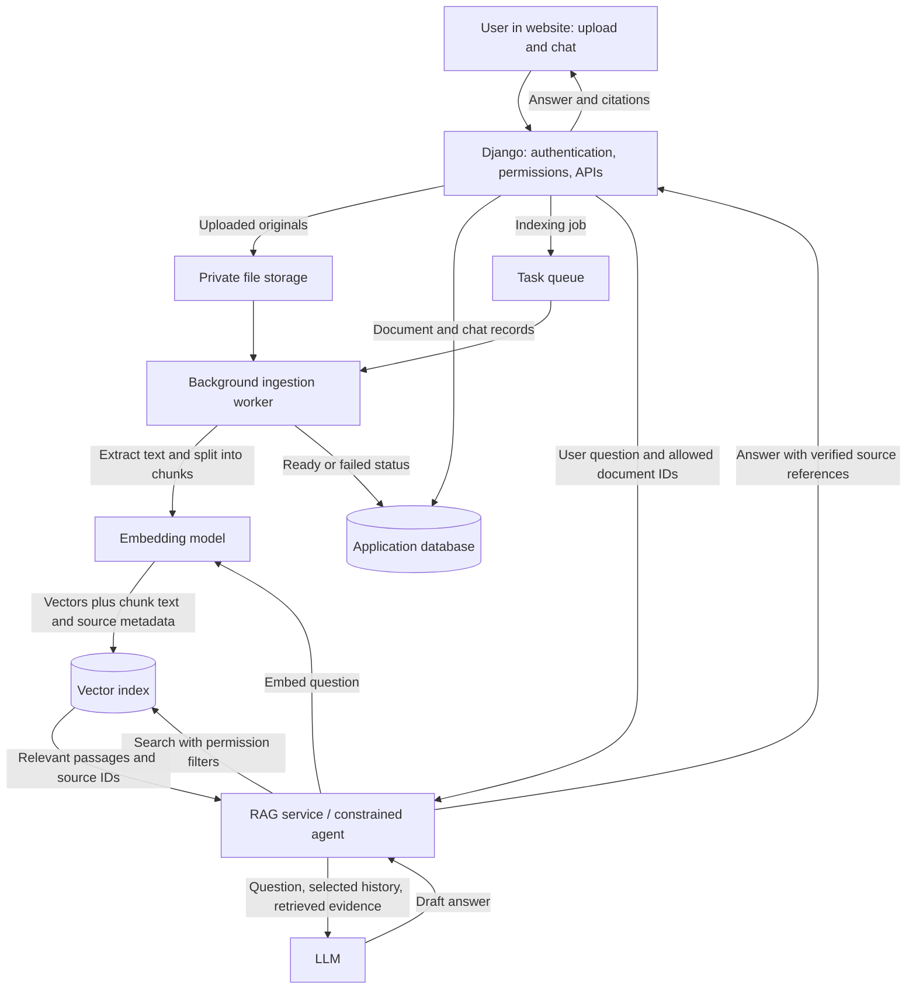
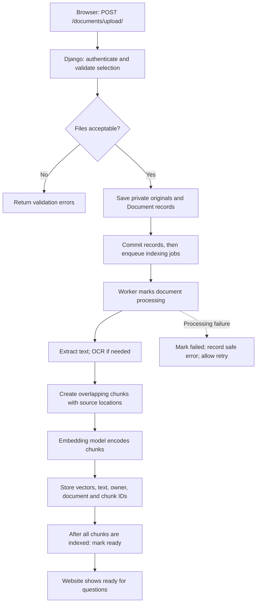
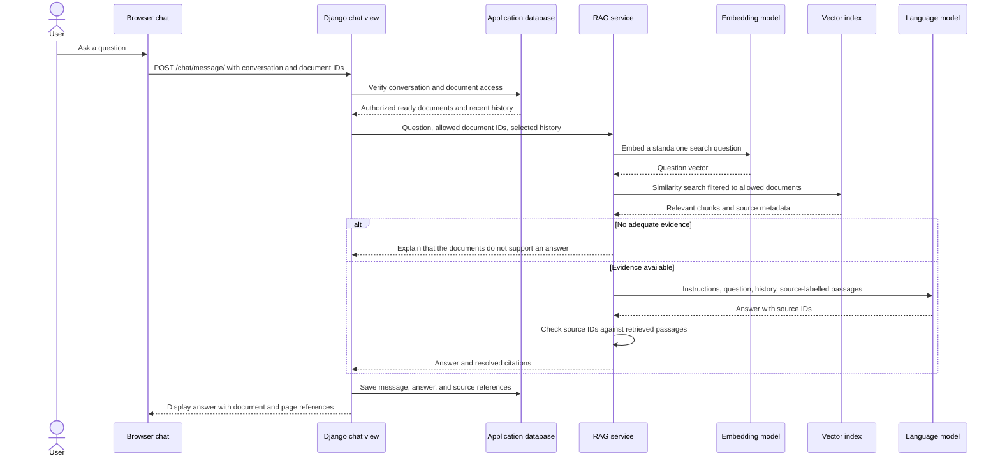

# Django document chatbot: RAG architecture

This is a proposed design for your existing Django project. Users upload several documents, then ask questions in a website chat. Django finds relevant passages in those documents and asks a large language model (LLM) to answer using that evidence. No chatbot code has been implemented by this document.

RAG means **Retrieval-Augmented Generation**: retrieve useful source material first, then generate an answer. Uploading documents does not train or fine-tune the LLM. The application supplies selected passages when it asks the model a question.

## 1. High-level architecture

There are two connected flows: preparing documents and answering questions. The chat should retrieve only from documents the current user is allowed to access.



### Main components

1. **Website:** A page with a multiple-file picker, document list, processing status, chat history, question box, and answers with source references.
2. **Django:** Handles login, upload validation, permissions, document records, chat requests, and responses. It remains the central application server.
3. **Private file storage:** Keeps the original documents. During local development this can be a private directory on your Mac. Files should be downloaded through permission checks rather than exposed under a public media URL.
4. **Application database:** Stores users, document ownership, status, conversations, messages, and citations. Your existing SQLite database can serve this role for a small local learning version.
5. **Task queue and worker:** The queue holds indexing work; a separate worker processes it without keeping the upload request open. This permits progress reporting and retries. A very small prototype can process synchronously, but large documents would make the browser wait and risk timeouts.
6. **Text extraction and chunking:** Extract readable text and split it into smaller passages. Preserve document IDs, chunk IDs, page numbers where available, and section labels. Scanned pages need OCR: extracting text from an image is a separate step.
7. **Embedding model:** Converts a passage or question into a numerical vector representing aspects of its meaning. It does not write the chat answer.
8. **Vector index:** Searches for passages similar to a question. It stores vectors and can also hold chunk text and metadata, or reference a separate chunk store. This design stores them together for simplicity.
9. **RAG service / constrained agent:** Coordinates authorized retrieval, builds the prompt, calls the LLM, checks cited source IDs, and returns the result. A fixed retrieve-then-answer workflow is enough initially; an autonomous agent choosing tools repeatedly is optional.
10. **LLM:** Produces a readable answer from the question and supplied evidence. It cannot automatically see your disk, database, or every uploaded document.

## 2. Low-level architecture: document ingestion

Ingestion means turning an uploaded file into searchable knowledge. A file being saved does not mean it is ready for questions.



### Step-by-step upload flow

1. The user selects several supported files and submits a multipart POST request. Browser forms include a CSRF token.
2. Django checks login, file count, sizes, and supported content. File extensions alone are insufficient validation. Set explicit supported formats; arbitrary files cannot all be parsed in the same way.
3. Save each original under a generated storage name and create its Document row with the owner and a `queued` status. Preserve the original name separately for display.
4. Commit database records before dispatching work so the worker can read them. Track enqueue failures and recover documents stuck in queued status. Database and file writes are separate: clean up incomplete uploads if a save fails.
5. The worker marks the document `processing`, extracts text, and detects empty or unreadable content. Password-protected, corrupt, and unsupported documents need clear failure messages. For images or scanned PDFs, run OCR if this feature is enabled.
6. Split text into chunks. For example, two neighbouring chunks may share a short overlap so a sentence at a boundary retains context. Chunk size and overlap should be tuned using sample questions, not treated as universal constants.
7. Create one embedding per chunk and store it with its text and metadata: owner or workspace ID, document ID, version, chunk ID, and page or section.
8. Mark a document `ready` only when all required chunks are searchable. On failure at any processing stage, mark it `failed`, retain a safe error summary, and support retry. Retrying must replace or reuse a document version rather than insert duplicate chunks.
9. The browser checks a status endpoint and shows progress. Each uploaded file has its own status; one failed document does not need to block other successful documents.

Suggested states: `queued → processing → ready`, with `failed` for errors. Search only the active, ready document version.

## 3. Low-level architecture: answering a chat question



### Step-by-step question flow

1. The browser sends the question, conversation ID, and chosen document IDs. The server must check all IDs; never trust ownership claimed by the browser.
2. Django verifies that the conversation belongs to the user and the selected documents are authorized and ready. If no document is ready, return a processing message rather than searching unrelated content.
3. Load a limited amount of conversation history. A follow-up such as “What about the second option?” may need a standalone search question derived from that history. Treat this rewrite as optional logic and retain the original question for answering.
4. Embed the search question using the same compatible embedding model and vector dimensions used to index the documents. Changing embedding models normally requires re-indexing existing chunks.
5. Search the vector index with owner/workspace and allowed document filters applied during retrieval. Fetch a small set of useful passages, remove duplicates, and optionally rerank them. Similarity is a retrieval signal, not proof that an answer is supported.
6. Build a prompt containing the question, selected history, and passages labelled with source IDs. Limit the evidence to fit the model's context window: its maximum input capacity. The LLM does not receive every file by default.
7. Instruct the LLM to answer from evidence, cite sources, and say when the evidence is insufficient. Treat document text as untrusted content, not instructions or permission to run tools.
8. Resolve source IDs to documents the user can access and verify that citations refer to retrieved passages. Valid IDs do not prove every claim is correct, so test answer grounding with example questions. Show page numbers only when extraction preserved them; otherwise show a section or passage reference.
9. Save the answer and citations, then display them in the chat. Model or retrieval failures should show a retryable error rather than an invented answer. Token streaming can be added later; a normal completed response is simpler first.

## 4. What the knowledge base contains

The knowledge base is the combination of original files, extracted passages, their vectors, and source metadata. It is not just a folder or just the LLM.

| Storage | Contents | Purpose |
| --- | --- | --- |
| Private file storage | Original documents | Preserve uploaded sources |
| Application database | Owners, document states, chat messages, citations | Permissions and application history |
| Vector index | Chunk text, embeddings, source IDs, ownership filters | Retrieve relevant evidence |

Example: `handbook.pdf → extracted text → many chunks → one vector per chunk`. A question retrieves only the relevant chunks before the LLM writes its answer. One file can produce many index entries.

## 5. Suggested database entities

| Entity | Important fields | Relationship |
| --- | --- | --- |
| User | Django user ID | Owns documents and conversations |
| Document | ID, owner, original name, private file path, size, status, version, error summary, timestamps | One user has many documents |
| Conversation | ID, owner, title, timestamps | One user has many conversations; optionally restrict to selected documents |
| Message | ID, conversation, role, content, timestamp | One conversation has many messages |
| Citation | Message, document ID/version, chunk ID, page or section, quoted excerpt | One answer can cite several passages |
| Indexed chunk | Chunk ID, document/version, owner/workspace, text, vector, source location | Many chunks per document, stored in the vector index in this design |

Store source versions or excerpts with citations so an old chat does not silently point to changed content. File deletion should remove originals and indexed chunks, revoke access immediately, and apply a defined retention policy to historical quotes and chats. Database and vector-index changes require coordinated cleanup; they are not automatically one transaction.

## 6. How this fits into your Django project

These are proposed additions, not existing files. Keep your current Hello World and About views while building the new feature in a separate `knowledge` app.

```text
helloworld/
├── manage.py
├── db.sqlite3
├── helloworld/
│   ├── settings.py              # Register apps, storage, queue, model settings
│   └── urls.py                  # Include knowledge URLs; retain current pages
├── home/                       # Existing Hello World and About pages
├── knowledge/                  # Proposed new Django app
│   ├── models.py               # Document, Conversation, Message, Citation
│   ├── forms.py                # Upload validation
│   ├── urls.py                 # Upload, status, chat, authorized source routes
│   ├── views.py                # HTTP requests, permissions, responses
│   ├── tasks.py                # Background indexing jobs
│   ├── services/
│   │   ├── extraction.py       # Read supported formats; optional OCR
│   │   ├── chunking.py         # Split text and preserve source locations
│   │   ├── embeddings.py       # Encode passages and questions
│   │   ├── retrieval.py        # Authorized vector search
│   │   └── answering.py        # Prompt, LLM call, citation checks
│   ├── templates/knowledge/
│   │   └── workspace.html      # Upload controls, document statuses, chat
│   ├── static/knowledge/
│   │   └── chat.js             # Send messages and update the page
│   ├── migrations/
│   └── tests.py                # Permissions, indexing, retrieval, chat behavior
└── private_uploads/             # Local originals; not publicly served
```

Suggested endpoints:

| Method and URL | Purpose |
| --- | --- |
| `GET /knowledge/` | Show upload and chat workspace |
| `POST /documents/upload/` | Save files and queue indexing |
| `GET /documents/` | List the current user's documents and statuses |
| `POST /chat/message/` | Ask a question and receive an answer with citations |
| `GET /documents/<id>/download/` | Download a source after checking access |
| `POST /documents/<id>/delete/` | Revoke access and coordinate cleanup; require CSRF protection |

The queue and vector index are logical components: they may run locally or as separate services. Their implementation choices are deliberately unspecified here. Keep provider API keys on the server, outside source control. When using hosted embedding or language models, selected document content is sent to those providers; choose this data boundary deliberately.

## 7. Example from upload to answer

1. A user uploads `leave-policy.pdf` and `staff-handbook.pdf`.
2. Django saves the originals and shows both as queued or processing.
3. The worker extracts text, creates chunks, indexes embeddings, and marks the documents ready.
4. The user asks, “How many days of annual leave do employees get?”
5. Retrieval searches only that user's selected, ready documents and finds the relevant policy passage.
6. The LLM writes an answer grounded in the passage, with a reference such as “leave-policy.pdf, page 3.” This is an illustrative citation, not a claim about an actual uploaded document.
7. If the documents do not contain an answer, the chatbot says it could not find sufficient information instead of guessing.

## 8. A beginner-friendly build order

1. Build login and private multiple-file uploads; confirm ownership checks.
2. Extract text from one supported format and show processing status.
3. Add chunking, embeddings, and vector retrieval; inspect the retrieved passages before adding the LLM.
4. Add the LLM answer step and source citations.
5. Add the website chat interface and limited conversation history.
6. Test two users with separate files, unsupported questions, corrupt files, failed indexing, retries, and deletion. Check that one user's questions never retrieve another user's private documents.

Start with a constrained RAG workflow. Introduce an agent that selects additional tools only when a concrete task needs it. The essential path is: **upload → extract → chunk → embed → retrieve → answer with sources**.
